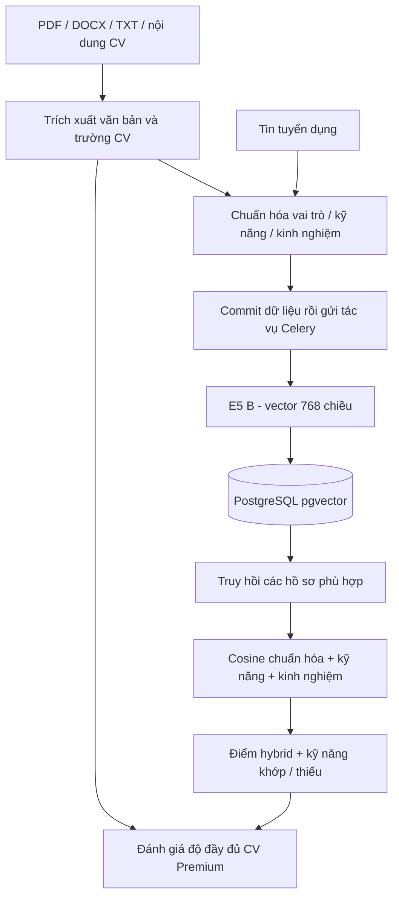

# Pipeline dữ liệu và AI JobMatch

Phương pháp đã hoàn thành là profile → E5 fine-tune → cosine → hybrid. Chương 5 của SRS JobMatch trình bày dữ liệu, huấn luyện, công thức điểm, thiết kế thực nghiệm và kết quả. Bản báo cáo thực nghiệm là tài liệu nháp dùng để biên soạn; người đọc không cần tra bản nháp để hiểu phần AI trong SRS. Môi trường thực nghiệm tại mục 5.9 dùng ma trận NumPy; sơ đồ dưới mô tả cùng lõi trong nhánh tích hợp web với pgvector và Celery.

## Luồng vận hành



- `cv_parser.py`: đọc PDF/DOCX/TXT và nhận diện thông tin, kỹ năng, kinh nghiệm. Chưa có OCR cho CV ảnh scan.
- `embedder.py`: dùng hồ sơ chuẩn hóa từ `data_pipeline/profile_text.py`, giống định dạng các thí nghiệm SBERT. E5 thêm prefix tương ứng trong bộ mã hóa đang dùng.
- `repositories/matching.py`: truy hồi pgvector có lọc Job còn mở, CV mặc định của tài khoản còn hoạt động, tên model và số chiều.
- `reranking.py`: tùy chọn Cross-Encoder trong source web, ngoài phương pháp và bảng thực nghiệm tại Chương 5 SRS.
- `matcher.py`: với cấu hình theo phương pháp tại Chương 5 SRS, kết hợp cosine chuẩn hóa, độ phủ kỹ năng và kinh nghiệm; trả kỹ năng khớp/thiếu và giải thích.
- `cv_evaluation.py`: điểm đầy đủ CV 0..100 theo bằng chứng đã trích xuất. `match_score` 0..1 chỉ có khi chọn Job. Gợi ý có điều kiện, không tự ghi thêm kỹ năng/kinh nghiệm vào CV; `can_apply=true`.

Cấu hình E5 B tại mục 5.6 SRS: SCORE_W_SEMANTIC=0.4, SCORE_W_SKILL=0.5, SCORE_W_EXP=0.1, SCORE_COS_FLOOR=0 và CROSS_ENCODER_MODEL rỗng. Semantic = clip(cosine, 0, 1); điểm hybrid kết hợp semantic/coverage/experience. Mặc định source hoặc .env có thể khác cấu hình nghiên cứu; lưu cấu hình chạy thực tế khi tái lập.

Đánh giá CV dùng quy tắc đo độ đầy đủ, tách khỏi matching với JD. LLM hỗ trợ dữ liệu nghiên cứu, không chấm matching trong request. Kết quả dưới `results/` là hồ sơ kiểm chứng các bảng E5/cosine/hybrid và parser tại mục 5.9 SRS; không thay thế benchmark pgvector, worker hoặc API.

## Chuẩn bị dữ liệu và nghiên cứu

Chạy tại root sau khi cài dependency:

```powershell
python -m pip install -e './backend[ai,research]'
python -m data_pipeline.run_all
python -m ml.evaluate --split test --text profile
python -m ml.train_biencoder --model e5-base --text profile --data clean
python -m ml.eval_parser
```

`data_pipeline.run_all` tạo lại các tập dữ liệu và file CV; không cần chạy lại để khởi động website. Bước render PDF `s04_render_files.py` hiện dùng các font trong `C:/Windows/Fonts`, cần Windows hoặc sửa cấu hình font trước khi dùng trên Linux. Bộ source được giữ để nghiên cứu, không đưa bước render vào Docker runtime của website.

`llm/compare_models.py`, `llm/augment.py`, `data_pipeline/s06_merge_llm.py` là công cụ thí nghiệm bổ sung dữ liệu. Cấu hình `OPENROUTER_API_KEY` tại root hoặc trong môi trường. Các công cụ này không được gọi tự động trong request tuyển dụng.

## Dữ liệu/model đã giữ

- `data/raw`, `processed`, `final`, `annotation`, `cv_files`, `llm`: dữ liệu gốc, dữ liệu chuẩn hóa và nhãn.
- `models/cvjd-e5-base-profile`, `cvjd-e5-base-profile-clean`, `cvjd-e5-base-full-clean`: các cấu hình nghiên cứu; chọn checkpoint B profile-clean.
- `results`: kết quả parser, cosine và hybrid được trình bày, phân tích tại mục 5.9 SRS.
- `docs/research/KET_QUA_THUC_NGHIEM.md`: tổng hợp kết quả nghiên cứu.

