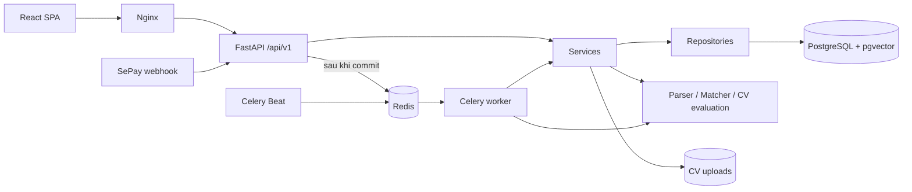

# Kiến trúc thống nhất

Thiết kế dựa trên phần 2.8, 4.1, 4.4, 4.7 và các cập nhật giao diện ứng viên trong đặc tả JobMatch.

Lõi AI đã hoàn thành là profile → E5 → cosine → hybrid, được đặc tả và đánh giá tại Chương 5 của SRS. Dữ liệu, quy trình huấn luyện, công thức tính điểm, thiết kế thực nghiệm và các bảng kết quả nằm ngay trong tài liệu chính thức. Sơ đồ trên là nhánh tích hợp web; pgvector, worker và API có phạm vi kiểm chứng riêng. Cấu hình tái hiện phương pháp trong SRS dùng E5 B, trọng số 0,40/0,50/0,10, floor 0 và CROSS_ENCODER_MODEL rỗng; source còn tùy chọn CE với mặc định riêng, ngoài phạm vi thực nghiệm.

## Ranh giới các lớp

| Thành phần | Trách nhiệm | File đại diện |
|---|---|---|
| `api/v1` | Route HTTP, dependency xác thực, schema đầu vào; gọi service | `jobs.py`, `cvs.py`, `applications.py` |
| `schemas` | Kiểm tra dữ liệu theo tài nguyên; không chia theo vai trò | `jobs.py`, `cvs.py`, `interviews.py` |
| `services` | Quyền sở hữu, nghiệp vụ, transaction, điều phối AI và thông báo | `jobs.py`, `matching.py`, `payments.py` |
| `repositories` | Truy vấn, khóa bản ghi, compare-and-set, tìm vector | `jobs.py`, `interviews.py`, `matching.py` |
| `models.py` | Bảng, quan hệ, khóa ngoại và ràng buộc dữ liệu | SQLAlchemy ORM |
| `ai` | Chuyển nội dung thành hồ sơ, vector, điểm và giải thích | `embedder.py`, `matcher.py`, `reranking.py` |
| `tasks` | Tác vụ Celery và thời điểm chạy | `embedding_tasks.py`, `celery_app.py` |
| `core` | Session, JWT/RBAC, kiểu vector, thời gian UTC | `database.py`, `security.py`, `vector.py` |

API không truy vấn ORM trực tiếp. Repository không import service hoặc API. Service quyết định khi commit/rollback; các hàm cập nhật trạng thái dùng chung nằm trong `state_machines.py`. Cấu trúc này được kiểm tra bằng bài kiểm thử ranh giới import và truy vấn.

`payment_api.py` điều phối đơn hàng và phản hồi HTTP ở lớp service; `payments.py` chứa các nghiệp vụ kích hoạt gói, webhook, hoàn tiền và đối soát. Hai module phục vụ cùng miền thanh toán, không phải hai backend.

## Xử lý CV và tin tuyển dụng

1. API tiếp nhận CV hoặc Job, kiểm tra vai trò và quyền sở hữu.
2. Service trích xuất nội dung/kỹ năng, lưu dữ liệu và tăng `embedding_revision`.
3. Dữ liệu ở trạng thái `PENDING`; lệnh tính vector được gửi sau khi transaction commit.
4. Worker đọc dữ liệu đã commit, tính vector và chỉ ghi kết quả nếu revision chưa thay đổi.
5. Kết quả có `embedding_model`, `processing_status=READY`. Công việc cũ bị bỏ qua khi CV/Job đã được sửa.

Nếu broker không nhận được công việc, bản ghi vẫn là `PENDING`; Beat quét lại các bản ghi này mỗi 5 phút. Model được nạp khi tác vụ AI thực sự cần đến, tránh tải model trong startup FastAPI.

Nhánh tích hợp web dùng PostgreSQL/pgvector; SQLite có đường tính NumPy cho kiểm thử. Môi trường thực nghiệm tại mục 5.9 SRS dùng ma trận NumPy trong RAM cho cùng cơ chế E5/cosine/hybrid. Bảng kết quả NumPy không chứng minh hiệu năng HNSW, worker hoặc API.

## Lịch phỏng vấn và ứng tuyển

Ứng viên giữ slot có thời hạn rồi xác nhận đặt lịch. Việc đổi trạng thái dùng điều kiện trạng thái cũ và ràng buộc unique, giữ tính nhất quán khi nhiều request đến cùng lúc. Ứng tuyển chỉ yêu cầu tin còn mở và CV thuộc ứng viên; điểm thấp, vector đang xử lý hoặc lỗi model không chặn việc nộp hồ sơ. Lỗi chấm điểm được ghi log, đơn vẫn lưu với điểm để trống; HR vẫn mở được hồ sơ.

Lịch sử chuyển trạng thái được lưu riêng. Một ứng viên chỉ có một đơn còn hoạt động cho cùng Job; đơn đã bị từ chối hoặc rút được giữ làm lịch sử và cho phép nộp đơn mới. HR chỉ xem danh tính/CV theo phạm vi ứng tuyển vào công ty của họ. Danh sách AI trước khi ứng tuyển dùng tên và tiêu đề hồ sơ ẩn danh.

## Thanh toán và công việc định kỳ

Webhook được kiểm tra khóa SePay, mã giao dịch unique, mã đơn, số tiền và thời hạn đơn. Giao dịch lặp không cộng quyền lợi lần nữa; sai số tiền hoặc chuyển tiền muộn được lưu để đối soát. Chức năng giả lập thanh toán chỉ hoạt động khi `ENABLE_DEV_TOOLS=true`.

Celery Beat chạy một tiến trình riêng với múi giờ `Asia/Ho_Chi_Minh`:

- Mỗi phút: thu hồi hold và đóng đơn/tin đã hết hạn.
- Mỗi 5 phút: gửi lại việc tính vector còn chờ.
- 00:00 giờ Việt Nam: kiểm tra tính nhất quán thanh toán nội bộ.

Không dùng APScheduler trong API. Hiện đối soát dựa trên giao dịch webhook đã lưu; phần lấy lịch sử giao dịch từ API SePay chưa được triển khai.

## Mã nghiên cứu và tài liệu

`data_pipeline`, `ml`, `llm` phục vụ chuẩn bị dữ liệu, huấn luyện và đánh giá; không khởi động server riêng. Backend dùng chung `data_pipeline/profile_text.py` và vocab để định dạng hồ sơ phù hợp với thí nghiệm. Chạy nghiên cứu bằng `python -m ...` tại root sau khi cài dependency tương ứng.

SRS JobMatch là tài liệu chính thức, tự chứa nội dung phương pháp và thực nghiệm AI tại Chương 5. Chương 3 của bản báo cáo thực nghiệm là tài liệu nháp đã dùng để biên soạn, không phải tài liệu cần đọc kèm SRS. Sơ đồ AI đã đồng bộ nằm trong `docs/assets/chapter5`. Các tài liệu nguồn khác, sơ đồ và ảnh giao diện nằm trong `docs/source`. Model, dataset và JSON kết quả là hồ sơ kiểm chứng, tái lập các thực nghiệm đã trình bày trong SRS; xem [pipeline AI](ai-pipeline.md).

Các yêu cầu chức năng và bảng dữ liệu chưa hoàn thành được ghi trong [bảng đối chiếu](specification-alignment.md).
