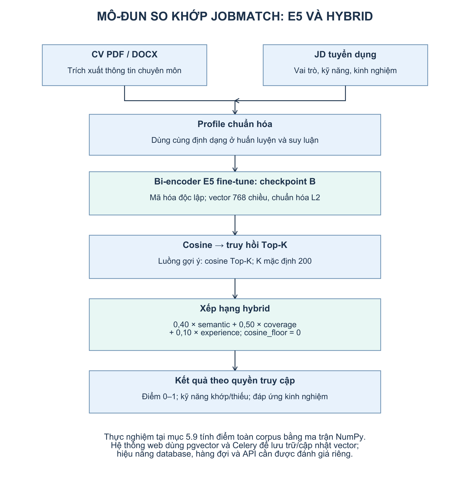
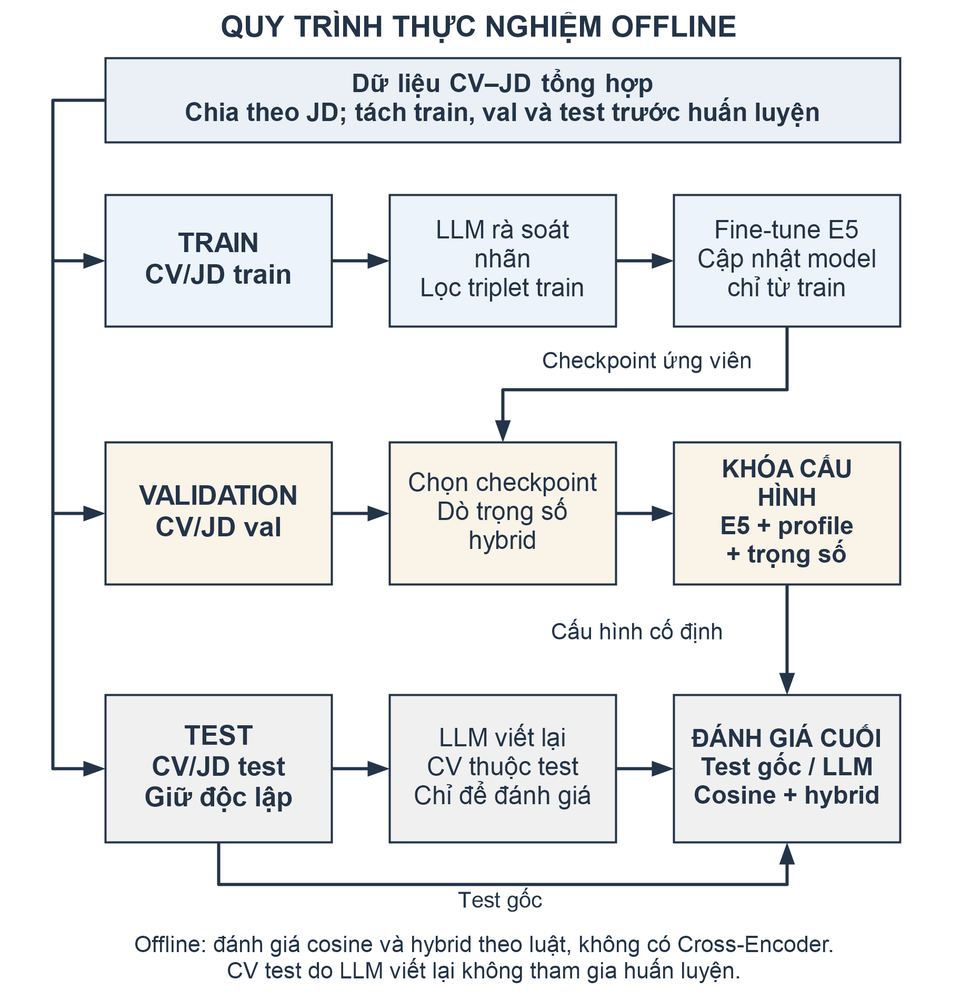

# CHƯƠNG 5. MODULE AI SO KHỚP CV–JD

Mô-đun AI của JobMatch hỗ trợ tìm việc phù hợp cho ứng viên và tìm hồ sơ phù hợp cho nhà tuyển dụng. Phương pháp sử dụng profile chuyên môn đã chuẩn hóa, bi-encoder E5 fine-tune và điểm hybrid kết hợp độ tương đồng ngữ nghĩa, độ phủ kỹ năng, mức đáp ứng kinh nghiệm. Chương này trình bày đầy đủ dữ liệu, phương pháp trích xuất và biểu diễn, quy trình huấn luyện, thuật toán so khớp, thiết kế tích hợp, thực nghiệm và giới hạn sử dụng. Các kết quả tại mục 5.9 là cơ sở đánh giá và lựa chọn cấu hình AI của hệ thống.

## 5.1. Bài toán, phạm vi và kiến trúc tổng thể

### 5.1.1. Mục tiêu và đầu vào, đầu ra

Bài toán so khớp gồm hai chiều: từ một CV, xếp hạng các tin tuyển dụng phù hợp; từ một JD, xếp hạng các hồ sơ phù hợp trong phạm vi nhà tuyển dụng được phép truy cập. Mô-đun cung cấp thứ tự ưu tiên, điểm thành phần và chênh lệch kỹ năng để người dùng kiểm tra cơ sở của kết quả.

Đầu vào CV là tệp PDF/DOCX cùng các trường được trích xuất, gồm chức danh, kỹ năng, kinh nghiệm và học vấn. Đầu vào JD gồm chức danh, mô tả công việc, nhóm nghề, cấp bậc, kỹ năng yêu cầu và số năm kinh nghiệm tối thiểu. Thông tin định danh và liên hệ được quản lý cho nghiệp vụ; profile dùng chấm mức phù hợp chuyên môn loại bỏ các trường này.

Đầu ra matching là danh sách được xếp hạng, kèm mã CV/JD, thông tin tóm tắt được phép xem, điểm phù hợp 0–1 và ba điểm thành phần. Chức năng đánh giá CV Premium bổ sung Điểm CV 0–100, tiêu chí mức độ đầy đủ và gợi ý dựa trên nội dung đã nhận diện. Điểm phù hợp gắn với một JD cụ thể; Điểm CV có thể tính độc lập khi chưa chọn JD. Cả hai hỗ trợ người dùng xem xét thông tin, còn quyết định tuyển dụng thuộc về nhà tuyển dụng.

### 5.1.2. Phương pháp và cấu hình lựa chọn

Luồng tính toán chính là trích xuất và chuẩn hóa → tạo profile → mã hóa E5 → tính cosine → kết hợp kỹ năng và kinh nghiệm → xếp hạng và giải thích. Bi-encoder mã hóa CV và JD độc lập, nhờ đó vector của một hồ sơ có thể được tạo trước và dùng lại trong nhiều phép so khớp. Thành phần ngữ nghĩa giúp so sánh nội dung chuyên môn; hai thành phần luật phản ánh các yêu cầu cụ thể của JD.

Cấu hình lựa chọn là checkpoint B `models/cvjd-e5-base-profile-clean`, được fine-tune từ `intfloat/multilingual-e5-base`. Profile có giới hạn 256 token, vector có 768 chiều và được chuẩn hóa L2. Điểm hybrid dùng trọng số ngữ nghĩa/kỹ năng/kinh nghiệm 0,40/0,50/0,10, với cosine floor bằng 0. Quy trình chọn checkpoint được trình bày ở mục 5.4; cách chọn trọng số và kết quả đối chứng được trình bày ở mục 5.9.

Thực nghiệm tính điểm bằng ma trận NumPy để đánh giá trên toàn corpus. Trong hệ thống web, PostgreSQL/pgvector quản lý vector cùng dữ liệu nghiệp vụ, còn Redis/Celery xử lý việc cập nhật embedding nền. Bảng 5.1 xác định trách nhiệm của các thành phần và phạm vi kiểm chứng tương ứng.

| Thành phần | Chức năng tính toán | Tích hợp hệ thống web |
|---|---|---|
| Biểu diễn | Profile chuẩn hóa; vector E5 fine-tune 768 chiều | Dùng cùng checkpoint B và phiên bản profile cho CV/JD |
| Kho vector | Ma trận NumPy dùng trong đánh giá offline | PostgreSQL/pgvector gắn vector với bản ghi nghiệp vụ |
| Xếp hạng | Cosine; điểm hybrid từ ngữ nghĩa, kỹ năng và kinh nghiệm | Cosine Top-K → hybrid → danh sách kết quả được phép xem |
| Cập nhật | Tạo lại vector khi profile thay đổi | Commit dữ liệu → Redis/Celery → ghi vector đúng revision |
| Đánh giá | Parser, bi-encoder và các biến thể hybrid tại mục 5.9 | Kiểm chứng riêng truy hồi gần đúng, hàng đợi, API và quyền truy cập |

Bảng 5.1. Thành phần tính toán và tích hợp của mô-đun AI

### 5.1.3. Phân công trách nhiệm và ràng buộc chung

API/Router xác thực và kiểm tra dữ liệu đầu vào. Service Layer kiểm tra quyền, điều phối so khớp và tạo kết quả nghiệp vụ. MatchingService sử dụng truy hồi cosine, điểm hybrid và phân tích kỹ năng; CVEvaluationService kiểm tra quyền Premium và đánh giá mức độ đầy đủ của CV. Repository Layer truy vấn bản ghi và vector. EmbeddingService tạo biểu diễn E5; RerankingService sắp lại thứ tự theo điểm hybrid; SkillAnalysisService xác định kỹ năng khớp, chưa được ghi nhận và bổ sung. Worker sử dụng cùng hàm tạo profile và embedding với luồng matching.

Ứng viên chỉ sử dụng CV thuộc sở hữu của mình; nhà tuyển dụng chỉ yêu cầu đề xuất cho tin thuộc quyền quản lý. Thông tin cá nhân của ứng viên chưa ứng tuyển bị giới hạn theo quy tắc nghiệp vụ. Điểm thấp, vector chưa sẵn sàng hoặc lỗi mô hình không khóa quyền nộp hồ sơ. Vector khác checkpoint hoặc khác phiên bản profile phải được tách khỏi truy vấn, kể cả khi có cùng số chiều.

## 5.2. Xây dựng, kiểm soát và chia dữ liệu

### 5.2.1. Nguồn JD và các bước làm sạch

Dữ liệu JD được xây dựng từ bộ IT-Job-Posting gồm 3.101 tin tuyển dụng IT thu thập từ LinkedIn, ITviec và TopCV, sử dụng cho mục đích nghiên cứu học tập. Các trường ban đầu gồm chức danh, doanh nghiệp, mô tả, địa điểm và công nghệ liên quan. Quy trình xử lý loại bản ghi trùng, loại mô tả quá ngắn, chuẩn hóa kỹ năng và quy vai trò về nhóm nghề thống nhất. Bảng 5.2 trình bày quy tắc và số bản ghi còn lại sau từng bước.

| Bước | Quy tắc chính | Số JD còn lại |
|---|---|---|
| Dữ liệu gốc | Nguồn tin tuyển dụng IT | 3.101 |
| Loại trùng và tin ngắn | Trùng mô tả hoặc cặp chức danh–doanh nghiệp; mô tả dưới 300 ký tự | 2.510 |
| Chuẩn hóa kỹ năng | Gộp biến thể; bỏ nhãn rỗng/quá chung; kỹ năng xuất hiện ít nhất 3 lần; mỗi JD có ít nhất 3 kỹ năng hợp lệ | 2.020 |
| Chuẩn hóa nhóm nghề | Quy 329 kiểu vai trò về 16 nhóm; loại tin ngoài phạm vi IT | 1.978 |

Bảng 5.2. Quy trình làm sạch dữ liệu JD

Tập cuối gồm 1.978 JD thuộc 16 nhóm nghề, từ vựng 384 kỹ năng và trung bình 7,4 kỹ năng/JD. Tỷ lệ ngôn ngữ là 38% tiếng Việt và 62% tiếng Anh. Phân bố tập trung ở Backend, Software Engineer, Full-stack và Frontend; các nhóm ít mẫu cần được xem xét riêng khi đánh giá khả năng tổng quát hóa. Số 384 là kích thước từ vựng kỹ năng, còn số chiều embedding E5 là 768.

### 5.2.2. Chuẩn hóa kỹ năng, nhóm nghề và cấp bậc

Tên kỹ năng được chuyển về khóa so khớp rồi tra bảng biến thể. Các tên ReactJS/React.js được quy về React, Golang về Go, Postgres về PostgreSQL, K8s về Kubernetes và MSSQL về SQL Server. Phép chuẩn hóa giữ các ký tự có ý nghĩa như + và # để phân biệt C++, C# với những tên khác. Từ vựng và bảng biến thể được dùng thống nhất khi sinh dữ liệu, trích xuất CV và phân tích chênh lệch kỹ năng.

Nhóm nghề được xác định từ loại vai trò và chức danh bằng các luật có thứ tự ưu tiên. Cấp bậc được nhận diện từ chức danh và mô tả, gồm Intern, Fresher, Junior, Middle, Senior và Lead; nếu văn bản ghi khoảng cấp bậc, mức thấp nhất được dùng làm yêu cầu tối thiểu. Số năm yêu cầu được đọc từ các mẫu như “ít nhất 3 năm kinh nghiệm” hoặc “2+ years of experience”. Dữ liệu chuẩn hóa vẫn cần được cho phép rà soát khi thông tin nguồn không rõ hoặc bộ trích xuất nhận diện sai.

### 5.2.3. Sinh CV tổng hợp có nhãn

CV được sinh có kiểm soát bằng template để xây dựng dữ liệu có các mức phù hợp khác nhau đối với JD. Mỗi JD sinh ba CV: một fit, một partial và một hard negative. Nhóm partial được chia thành thiếu kỹ năng hoặc thiếu kinh nghiệm; mỗi JD chỉ sử dụng một trong hai loại này. Tổng cộng có 5.934 CV. Bảng 5.3 mô tả quy tắc sinh, nhãn 0/1/2 và phân bố mẫu.

| Loại CV | Quy tắc sinh chủ yếu | Phủ kỹ năng TB | Nhãn | Số CV |
|---|---|---|---|---|
| Fit | Cùng nghề; có 80–100% kỹ năng JD; đủ số năm | 0,97 | 2 | 1.978 |
| Partial_skill | Cùng nghề; có 40–66% kỹ năng JD | 0,49 | 1 | 1.454 |
| Partial_senior | Cùng nghề; có 75–100% kỹ năng JD; thiếu 2–3 năm kinh nghiệm | 0,94 | 1 | 524 |
| Hard_neg | Khác nghề; chỉ trùng một số kỹ năng chung | 0,13 | 0 | 1.978 |

Bảng 5.3. Các nhóm CV tổng hợp

Bộ sinh thay đổi cách viết kỹ năng và thứ tự các mục; khoảng 20% kỹ năng chỉ xuất hiện trong mô tả kinh nghiệm. CV có tỷ lệ 55% tiếng Việt, 45% tiếng Anh, độ dài trung bình khoảng 190 từ. Các câu mô tả được ghép theo nhóm nghề và kỹ năng tương ứng để hạn chế nội dung không hợp lý. Từ tập test, 200 CV được xuất thành 67 PDF một cột, 67 PDF hai cột và 66 DOCX kèm đáp án cấu trúc để kiểm thử parser.

Nhãn ban đầu được suy từ điều kiện sinh và có thể tái lập khi cố định seed. Do quy tắc và câu mẫu có thể tạo trường hợp không phù hợp với thực tế, nhãn này được kiểm tra thêm bằng LLM tại mục 5.2.4 và không được xem là nhãn chuyên gia đã xác thực.

### 5.2.4. Vai trò của LLM trong chuẩn bị dữ liệu

LLM hỗ trợ hai tác vụ trong giai đoạn chuẩn bị dữ liệu: rà soát nhãn CV–JD và viết lại CV tổng hợp bằng văn phong đa dạng hơn. Thử nghiệm mẫu lựa chọn Nemotron-3-Super 120B cho việc viết lại và Nemotron-3-Ultra 550B cho việc chấm nhãn, với mô hình dự phòng khi cần. Việc lựa chọn dựa trên khả năng giữ dữ kiện, tuân thủ danh sách kỹ năng và tính nhất quán khi nhận xét mức liên quan. Luồng matching vận hành bằng E5 và các thành phần luật, không phụ thuộc vào lời gọi LLM.

LLM rà soát 5.252 cặp, gồm 4.752 cặp train và 500 cặp của bộ annotation. Tỷ lệ đồng thuận với nhãn luật lần lượt là 91,4% và 84,4%. Tập train ban đầu có 3.168 bộ ba; mỗi JD train ghép một positive fit với negative partial hoặc hard negative. Sau khi loại 365 bộ ba có nhãn bị đánh giá không phù hợp, tập sạch còn 2.803 bộ ba. Đồng thuận luật–LLM phản ánh mức nhất quán giữa hai cách đánh giá, không xác định một bên là chuẩn đúng tuyệt đối.

CV test được viết lại với ràng buộc giữ dữ kiện định danh, thời gian, học vấn và kỹ năng nguồn. Mỗi bản được kiểm tra tên, ngôn ngữ và danh sách kỹ năng; quy tắc dữ liệu tổng hợp cho phép tối đa hai kỹ năng chung như Git/SQL. Kết quả có 281 CV đạt yêu cầu. Tập test_llm gồm 188 JD và 281 CV; 9 JD test không có CV liên quan trong tập con bị loại. Toàn bộ CV viết lại thuộc test, không dùng để huấn luyện hoặc chọn checkpoint. Quy tắc tăng cường dữ liệu tổng hợp được tách khỏi gợi ý cho CV người dùng thật, vốn phải dựa trên bằng chứng do người dùng cung cấp.

### 5.2.5. Chia tập, kiểm soát rò rỉ và nhãn mức liên quan

Dữ liệu được chia theo JD, phân tầng theo nhóm nghề, với tỷ lệ mục tiêu 80/10/10 và seed 42. Các CV sinh từ một JD đi cùng tập với JD đó. Cách chia này tránh đưa cùng JD vào cả train và test thông qua những cặp CV–JD khác nhau. Train dùng cập nhật trọng số; val dùng chọn checkpoint và dò tham số; test dùng đánh giá cuối. Quy mô các tập được trình bày ở Bảng 5.4.

| Tập | Số JD | Số CV | Mục đích |
|---|---|---|---|
| Train | 1.584 | 4.752 | Sinh bộ ba và fine-tune |
| Val | 197 | 591 | Chọn checkpoint, dò trọng số baseline |
| Test | 197 | 591 | Báo cáo kết quả cuối |
| Test_llm | 188 | 281 | Kiểm tra xử lý văn bản viết lại; là tập con test |

Bảng 5.4. Quy mô các tập dữ liệu

Val và test được gán mức liên quan trên toàn ma trận JD × CV. Một CV sinh cho JD A có thể phù hợp với JD B, vì vậy chỉ giữ ba nhãn ban đầu sẽ bỏ sót các quan hệ liên quan. Tập nhãn truy hồi, gọi là qrels, được xác định theo Bảng 5.5; cặp không có nhãn liên quan được coi là mức 0.

| Mức | Điều kiện |
|---|---|
| 2 — phù hợp | Cùng nghề, phủ ít nhất 70% kỹ năng JD và số năm CV ≥ yêu cầu tối thiểu − 1 |
| 1 — phù hợp một phần | Chưa đạt mức 2; cùng nghề và phủ ít nhất 40%, hoặc nghề liên quan và phủ ít nhất 60% |
| 0 — chưa phù hợp theo luật | Các trường hợp còn lại |

Bảng 5.5. Luật gán mức liên quan val/test

Luật chấm ma trận đồng thuận 97,3% với nhãn lúc sinh. Mỗi JD test có trung bình khoảng 20 CV liên quan, trong đó khoảng 2–3 CV mức 2. Luật phụ thuộc nhiều vào kỹ năng và nhóm nghề nên có thể tạo lợi thế cho phương pháp kỹ năng/hybrid. Ngoài ra, từ vựng kỹ năng được xây dựng từ toàn bộ JD trước khi chia tập; chưa có đối chứng chỉ xây từ vựng trên train. Đây là hai giới hạn cần xét khi diễn giải khả năng tổng quát hóa. Các lần đánh giá trên JD mới cần cố định tiền xử lý từ train và bổ sung nhãn người chấm.

## 5.3. Trích xuất CV và xây dựng profile thống nhất

### 5.3.1. Đọc tệp và trích xuất có cấu trúc

Tệp PDF có lớp văn bản được đọc bằng PyMuPDF; DOCX được đọc bằng python-docx. Bộ trích xuất tách văn bản theo mục và sử dụng luật, biểu thức chính quy, từ vựng kỹ năng để nhận diện thông tin liên hệ, chức danh, cấp bậc, kỹ năng, kinh nghiệm, học vấn, dự án và chứng chỉ. CV dạng ảnh scan nằm ngoài phạm vi hiện tại vì chưa có bước OCR; tệp không đủ văn bản cần được thông báo để người dùng xử lý.

Kỹ năng được dò trong cả mục kỹ năng và mô tả kinh nghiệm, sau đó quy về tên chuẩn. Số năm kinh nghiệm được đọc từ câu mô tả hoặc tính từ khoảng thời gian làm việc; các khoảng chồng nhau chỉ tính một lần. Danh sách vị trí đã làm và ngành học bổ sung thông tin cho profile. Trường không nhận diện được giữ trạng thái thiếu, không được bổ sung từ yêu cầu JD.

Kết quả cấu trúc được lưu vào `parsed_data`; văn bản đọc được lưu vào `raw_text` để kiểm tra nguồn và trình bày. Người dùng có thể rà soát, chỉnh dữ liệu nhận diện sai. Khi thay đổi nội dung ảnh hưởng đến profile, hệ thống cập nhật revision và tạo lại embedding trước khi sử dụng phiên bản mới cho matching.

### 5.3.2. Cấu trúc profile CV và JD

Profile là văn bản ngắn theo mẫu thống nhất, ưu tiên các dữ kiện chuyên môn để giảm nhiễu và hạn chế mất nội dung do giới hạn token. Hàm `data_pipeline.profile_text` được dùng chung khi xây dựng dữ liệu, huấn luyện, đánh giá và vận hành. Các trường profile được xác định ở Bảng 5.6.

| Profile | Trường đưa vào embedding | Trường không đưa vào |
|---|---|---|
| JD | Chức danh, nhóm nghề, cấp bậc, số năm tối thiểu, kỹ năng yêu cầu | Mã nội bộ, thông tin liên hệ và dữ liệu vận hành |
| CV | Chức danh, cấp bậc, số năm, kỹ năng, vị trí và thời gian đã làm, ngành học | Họ tên, email, điện thoại, địa chỉ và định danh cá nhân |

Bảng 5.6. Cấu trúc profile cho bi-encoder

Ví dụ JD: “Vị trí: Java Backend Developer. Nhóm: Lập trình viên Backend. Cấp bậc: Middle, yêu cầu tối thiểu 2 năm kinh nghiệm. Kỹ năng yêu cầu: Java, Spring Boot, PostgreSQL, Docker, Kafka.”

Ví dụ CV: “Ứng viên: Senior Backend Developer. Cấp bậc: Senior, 4 năm kinh nghiệm. Kỹ năng: Java, Spring Boot, PostgreSQL, Redis, Docker. Kinh nghiệm: Senior Backend Developer (2023–nay); Junior Backend Developer (2022–2023). Học vấn: Công nghệ thông tin.”

Với cặp này, tập kỹ năng khớp gồm Java, Spring Boot, PostgreSQL và Docker; Kafka chưa được ghi nhận trong CV. Mức đáp ứng kinh nghiệm bằng 1 vì CV có 4 năm và JD yêu cầu 2 năm. Thành phần ngữ nghĩa được tính từ hai vector E5, còn các tập kỹ năng và số năm cung cấp cơ sở giải thích trực tiếp.

### 5.3.3. Tiền tố, độ dài token và chuẩn hóa vector

Pipeline thêm tiền tố `query: ` cho cả profile CV và JD trước khi mã hóa; quy ước này được giữ thống nhất với dữ liệu fine-tune và checkpoint. Mô hình nền `intfloat/multilingual-e5-base` sử dụng XLM-RoBERTa 12 lớp, mean pooling và chuẩn hóa L2 để tạo vector 768 chiều [10]. Checkpoint lựa chọn là `models/cvjd-e5-base-profile-clean`.

Profile được giới hạn ở 256 token theo tokenizer; biến thể toàn văn đối chứng sử dụng 384 token. Phần vượt giới hạn bị cắt theo cấu hình mô hình, vì vậy thứ tự trường, prefix và giới hạn token là một phần của metadata cần lưu. Sau chuẩn hóa L2, vector có độ dài bằng 1 và cosine tương đương tích vô hướng.

Kiểm tra tái tạo profile cho kết quả 1.978/1.978 JD và 5.934/5.934 CV giống dữ liệu huấn luyện từng ký tự. Kiểm tra này xác nhận tính nhất quán của mẫu đầu vào giữa các giai đoạn. Chất lượng trích xuất từ tệp được đánh giá riêng tại mục 5.9.7.

## 5.4. Huấn luyện và lựa chọn bi-encoder E5

### 5.4.1. Bộ ba huấn luyện và hàm mất mát

Mỗi mẫu là bộ ba gồm JD, CV phù hợp và CV ít hoặc không phù hợp. Positive được lấy từ nhóm fit; negative lấy từ partial hoặc hard negative. Hàm `CachedMultipleNegativesRankingLoss` khuyến khích vector JD gần positive hơn các negative, bao gồm CV của những mẫu khác trong batch. Phiên bản cached chia tính toán thành các khối nhỏ, cho phép sử dụng batch hiệu dụng lớn trong giới hạn bộ nhớ GPU [12].

Với JD thứ i trong batch, CV positive là pᵢ và D là tập CV positive/negative của batch, loss được biểu diễn bằng Lᵢ = −log[exp(α × cos(JDᵢ, pᵢ)) / Σᵈ∈ᴰ exp(α × cos(JDᵢ, d))]. Loss của batch là trung bình Lᵢ. Cấu hình lưu trong model card dùng α = 20, hàm tương đồng cosine và chiều học JD→CV. Khi tối ưu, mô hình tăng điểm của positive so với các CV cạnh tranh; vector vẫn được mã hóa độc lập để sử dụng cho truy hồi hai chiều.

Batch sampler `NO_DUPLICATES` hạn chế đầu vào trùng trong cùng batch. Tuy nhiên, CV của một JD khác vẫn có thể phù hợp với JD đang xét và trở thành false negative. Lọc nhãn bằng LLM giảm nhiễu của bộ ba nguồn nhưng không loại hết tình huống này; kiểm soát negative cùng nghề là một hướng cải thiện tiếp theo.

### 5.4.2. Cấu hình và các biến thể đối chứng

Huấn luyện sử dụng cùng mô hình nền, loss và seed để so sánh ảnh hưởng của dạng đầu vào và chất lượng dữ liệu. Bảng 5.7 ghi các tham số, còn Bảng 5.8 trình bày ba cấu hình A, B và C.

| Tham số | Giá trị cấu hình |
|---|---|
| Mô hình nền | intfloat/multilingual-e5-base; embedding 768 chiều |
| Dữ liệu train | 3.168 bộ ba gốc hoặc 2.803 bộ ba sau lọc |
| Loss và sampler | CachedMultipleNegativesRankingLoss; NO_DUPLICATES |
| Batch hiệu dụng / khối nhỏ | 64 / 16 với profile; 64 / 8 với toàn văn |
| Learning rate / số epoch / seed | 2e-5 / 3 / 42 |
| Warmup lưu trong cấu hình | warmup_steps = 0.1; warmup_ratio = None; giữ giá trị và phiên bản thư viện khi tái lập |
| Giới hạn đầu vào | 256 token profile; 384 token toàn văn |
| Môi trường huấn luyện | fp16, NVIDIA RTX 4050 Laptop 6 GB |
| Đánh giá và lưu checkpoint | Mỗi 25 bước; chọn tốt nhất theo val_cosine_ndcg@10 |

Bảng 5.7. Cấu hình huấn luyện bi-encoder

Tham số warmup được lưu là `warmup_steps=0.1`, `warmup_ratio=None`. Transformers mô tả giá trị float trong [0,1) của `warmup_steps` như tỷ lệ tổng bước [14]; khi tái lập cần giữ cả giá trị và phiên bản thư viện. Môi trường huấn luyện được ghi nhận gồm Python 3.12.7, Sentence Transformers 6.1.0, Transformers 5.17.0 và PyTorch 2.11.0+cu128. Thời gian ở Bảng 5.8 là thời gian của lần chạy trên phần cứng tại Bảng 5.7.

| Cấu hình | Dạng đầu vào / dữ liệu | NDCG val trước | NDCG val tốt nhất | Checkpoint | Thời gian train |
|---|---|---|---|---|---|
| A | Profile / 3.168 bộ ba gốc | 0,6577 | 0,8388 | Step 25 | 4,6 phút |
| B | Profile / 2.803 bộ ba sạch | 0,6577 | 0,8467 | Step 25 | 4,1 phút |
| C | Toàn văn / 2.803 bộ ba sạch | 0,3105 | 0,6762 | Step 132 | 16,0 phút |

Bảng 5.8. So sánh ba cấu hình huấn luyện trên val nhị phân

Cấu hình A và B dùng cùng dạng profile nhưng khác số bộ ba, giúp xem xét tác động của lọc nhãn. B và C dùng cùng dữ liệu sạch nhưng khác dạng đầu vào, giúp so sánh profile với toàn văn. Trong lần chạy này, B đạt giá trị val tốt nhất, còn đầu vào toàn văn ở C có chất lượng thấp hơn và thời gian huấn luyện dài hơn.

### 5.4.3. Chọn checkpoint và phạm vi kết luận

Cấu hình B được chọn với checkpoint step 25, đạt NDCG@10 val nhị phân 0,8467. Checkpoint cuối step 132 đạt khoảng 0,8134, vì vậy `load_best_model_at_end` nạp lại step 25 để lưu và đánh giá. Kết quả cho thấy việc chọn checkpoint theo val phù hợp hơn việc mặc định dùng trạng thái cuối epoch 3 trong lần chạy này.

Bộ đánh giá chọn checkpoint quy cả nhãn 1 và 2 thành liên quan nhị phân. NDCG test tại mục 5.9 dùng nhãn phân cấp với gain `2^rel − 1`. Do khác định nghĩa, giá trị val 0,8467 và giá trị test 0,8418 không được sử dụng để tính mức giảm chất lượng trực tiếp. Test được giữ ngoài quá trình chọn step và dò trọng số hybrid.

Cấu hình B được lựa chọn cho tầng truy hồi vì cải thiện chất lượng cosine trong các bối cảnh đánh giá. Hiệu quả của điểm cuối còn phụ thuộc các trọng số và nguồn nhãn; B kết hợp hybrid không đứng đầu mọi bảng. Việc triển khai cần giữ đúng checkpoint, tokenizer, prefix và profile của cấu hình đã chọn.

## 5.5. Truy hồi hai chiều bằng vector E5

### 5.5.1. Vai trò của tầng truy hồi

Tầng truy hồi tìm các đối tượng có profile gần truy vấn theo cosine. Với chiều CV → JD, truy vấn là hồ sơ ứng viên và corpus là các tin tuyển dụng đang mở. Với chiều JD → CV, truy vấn là tin thuộc quyền nhà tuyển dụng và corpus là hồ sơ mặc định của ứng viên hoạt động. Việc đổi chiều không thay đổi vai trò của JD trong công thức điểm: độ phủ luôn tính trên yêu cầu kỹ năng JD, còn kinh nghiệm luôn so số năm CV với yêu cầu JD.

E5 mã hóa mỗi profile thành vector 768 chiều đã chuẩn hóa L2. Vector từ E5 gốc được dùng cho đối chứng; vector từ checkpoint B được dùng cho cấu hình lựa chọn. Hai phiên bản này tạo các không gian biểu diễn khác nhau nên không được trộn trong một truy vấn.

Trong thực nghiệm offline, vector được giữ bằng ma trận NumPy. Phép nhân ma trận–vector phục vụ một truy vấn; nhân ma trận–ma trận tính điểm cho toàn bộ tập đánh giá. Trong hệ thống web, pgvector cung cấp kho vector gắn với bản ghi PostgreSQL và cho phép áp dụng các bộ lọc nghiệp vụ. Công thức cosine và hybrid được giữ thống nhất giữa hai cách lưu trữ.

### 5.5.2. Độ tương đồng và hai phương án lưu vector

Với vector CV là u và vector JD là v, cosine được xác định:

cos(u, v) = (u · v) / (‖u‖₂ × ‖v‖₂).

Do ‖u‖₂ = ‖v‖₂ = 1, cos(u, v) = u · v. NumPy tính tích vô hướng để tạo ma trận tương đồng; pgvector dùng khoảng cách cosine d(u, v) = 1 − cos(u, v) và truy hồi theo khoảng cách tăng dần. Cosine sau chuẩn hóa là thành phần ngữ nghĩa trong công thức hybrid tại mục 5.6.

Thiết kế pgvector sử dụng chỉ mục HNSW cho toán tử khoảng cách cosine trên vector 768 chiều [13]. Đây là phương án tìm kiếm lân cận gần đúng khi corpus lớn. Chất lượng và tốc độ phụ thuộc dữ liệu, bộ lọc, tham số chỉ mục và kế hoạch truy vấn; cần đo riêng Recall@K và độ trễ khi lựa chọn cấu hình vận hành. Các bảng tại mục 5.9 sử dụng tính điểm offline bằng NumPy.

Kho pgvector cho phép cột lưu các số chiều để hỗ trợ chuyển đổi dữ liệu cũ và kiểm thử. Truy vấn lọc theo số chiều và phiên bản mô hình, còn chỉ mục HNSW áp dụng cho biểu thức vector 768 chiều. Vector có nhãn `legacy` được giữ để bảo toàn dữ liệu nhưng phải được tính lại trước khi tham gia truy hồi của phiên bản mới. Cùng quy tắc tương thích này được áp dụng cho ma trận NumPy.

### 5.5.3. Điều kiện hợp lệ và luồng truy hồi hai chiều

Trước khi tính điểm, hệ thống kiểm tra quyền sở hữu CV hoặc JD truy vấn. Corpus JD chỉ gồm tin `PUBLISHED` còn thời hạn; corpus CV chỉ gồm CV mặc định của tài khoản ứng viên `ACTIVE`. Cả hai phía phải có embedding hợp lệ, cùng checkpoint và số chiều. Bản ghi đang chờ xử lý không được xem như một vector sẵn sàng. Bảng 5.9 tóm tắt các điều kiện cho hai chiều.

| Chiều truy hồi | Đối tượng truy vấn | Tập được truy hồi | Điều kiện đặc trưng |
|---|---|---|---|
| CV → JD | CV riêng của ứng viên hoặc CV mặc định | Tin tuyển dụng đang mở | `PUBLISHED`, chưa hết hạn, embedding đúng mô hình |
| JD → CV | Tin tuyển dụng thuộc nhà tuyển dụng | CV mặc định của ứng viên hoạt động | Tài khoản `ACTIVE`, embedding đúng mô hình |

Bảng 5.9. Hai chiều truy hồi và điều kiện hợp lệ

Luồng đề xuất lấy shortlist theo cosine rồi sắp lại bằng hybrid. Kích thước pool mặc định là 200; trong hàm xếp hạng, pool = max(200, k), với k là số lượng yêu cầu. Nếu corpus hợp lệ nhỏ hơn pool, toàn bộ đối tượng hiện có được chấm. Danh sách hiển thị mặc định tối đa 30 đối tượng; dịch vụ phía nhà tuyển dụng còn loại trùng theo ứng viên. Pool truy hồi và giới hạn hiển thị vì vậy là hai tham số riêng. Chất lượng toàn corpus tại mục 5.9 chưa đo riêng ảnh hưởng của giới hạn shortlist này.

Quy trình request gồm xác thực → xác định CV/JD hợp lệ → kiểm tra embedding → truy hồi cosine → chấm hybrid → sắp xếp và trả kết quả. Khi ứng viên chưa nộp hồ sơ, nhà tuyển dụng chỉ được xem mã ứng viên và thông tin tóm tắt được phép công khai; danh sách đề xuất không cấp thêm quyền xem tên thật, liên hệ hoặc nội dung CV đầy đủ.

## 5.6. Điểm hybrid từ cosine, kỹ năng và kinh nghiệm

### 5.6.1. Vai trò của bi-encoder và phép kết hợp hybrid

Bi-encoder E5 biểu diễn nội dung chuyên môn của CV và JD bằng các vector có thể tính trước. Cosine phản ánh độ gần của hai biểu diễn; độ phủ kỹ năng và mức đáp ứng kinh nghiệm phản ánh những yêu cầu định lượng của tin tuyển dụng. Ba tín hiệu bổ sung cho nhau và được giữ riêng để giải thích kết quả.

Hybrid là phép tổng có trọng số của ba thành phần, được sử dụng để sắp lại danh sách sau truy hồi. Tầng này chỉ cần vector và dữ liệu cấu trúc đã có, không phải mã hóa lại từng cặp văn bản. Các biến thể đối chứng ở mục 5.9 giúp đánh giá phần đóng góp của biểu diễn E5 và các thành phần luật đối với chất lượng xếp hạng.

### 5.6.2. Chuẩn hóa cosine và dữ liệu chấm điểm

Một cặp được chấm từ vector profile CV, vector profile JD, hai tập kỹ năng chuẩn hóa và số năm kinh nghiệm của hai phía. Vai trò CV/JD được giữ cố định trong công thức dù người dùng bắt đầu truy vấn từ hồ sơ hay tin tuyển dụng. Vector phải tuân theo cùng checkpoint, prefix và phiên bản profile.

Đặt cos là độ tương đồng cosine và floor là tham số hiệu chỉnh, với floor < 1. Thành phần ngữ nghĩa được đưa về đoạn [0, 1] theo công thức:

semantic = clip((cos − floor) / (1 − floor), 0, 1).

Hàm clip giới hạn kết quả trong [0, 1]. Cấu hình E5 B có floor = 0 nên semantic = clip(cos, 0, 1). Phép biến đổi đưa cosine về thang chung để kết hợp điểm, không hiệu chỉnh thành xác suất trúng tuyển. Floor được lưu cùng checkpoint và trọng số để tái lập cấu hình.

Khi đã có vector, tính cosine và hybrid không cần chạy Transformer cho từng cặp. Embedding chỉ được tạo khi profile mới hoặc thay đổi. Thời gian tạo vector và thời gian tính điểm từ vector sẵn có cần được phân biệt trong đánh giá hiệu năng.

### 5.6.3. Điểm phù hợp cuối cùng

Đặt J là tập kỹ năng JD, C là tập kỹ năng CV, yCV là số năm kinh nghiệm của ứng viên và yJD là yêu cầu tối thiểu. Hai điểm luật và điểm tổng được xác định:

coverage = |J ∩ C| / |J|, nếu |J| > 0; ngược lại coverage = 0.

experience = 1, nếu yJD ≤ 0; ngược lại experience = min(1, max(0, yCV / yJD)).

score = wsemantic × semantic + wskill × coverage + wexperience × experience.

Các trọng số không âm, tổng bằng 1. Cấu hình lựa chọn dùng wsemantic = 0,40, wskill = 0,50, wexperience = 0,10 và floor = 0. Bộ tham số được chọn bằng NDCG@10 trên val và lưu trong `results/hybrid_cvjd-e5-base-profile-clean.json`. Các biến thể đối chứng có tham số riêng tại Bảng 5.11; cấu hình vận hành cần khai báo rõ để bảo đảm cùng cách tính điểm với cấu hình lựa chọn.

Danh sách được sắp giảm dần theo score, kèm cosine, semantic, coverage và experience. Ví dụ minh họa, với cos = 0,85, coverage = 4/5 = 0,80 và experience = 1, điểm cuối là 0,40 × 0,85 + 0,50 × 0,80 + 0,10 × 1 = 0,84. Giá trị này minh họa công thức, không phải phép đo thêm trên một hồ sơ thực nghiệm.

JD không có kỹ năng nhận diện được nhận coverage = 0 để tránh chia cho 0; giao diện phải thể hiện đây là thiếu dữ liệu yêu cầu. Kết quả còn phụ thuộc chất lượng parser nên các trường kỹ năng và số năm cần được cho phép kiểm tra, hiệu chỉnh. Điểm phù hợp hỗ trợ ưu tiên xem hồ sơ và không là điều kiện bắt buộc để ứng tuyển.

### 5.6.4. Gap analysis và khả năng giải thích

Phân tích chênh lệch kỹ năng dùng ba tập: kỹ năng khớp = J ∩ C; kỹ năng chưa được ghi nhận trong CV = J \ C; kỹ năng bổ sung = C \ J. Coverage luôn lấy số kỹ năng JD làm mẫu số. Phân tích kinh nghiệm so sánh yCV với yJD và trả tỷ lệ đã giới hạn, thay vì đổi vai trò theo chiều truy hồi.

Kỹ năng chưa được ghi nhận phản ánh nội dung mà parser chưa tìm thấy trong CV, không xác nhận ứng viên không biết kỹ năng đó. Nếu đã có trải nghiệm, người dùng có thể bổ sung minh chứng thực tế; nếu chưa có, gợi ý hướng học và thực hành. Hệ thống không tự tạo dự án, chứng chỉ, thành tích hoặc thời gian làm việc để nâng điểm.

## 5.7. Đánh giá CV Premium và gợi ý cải thiện trung thực

### 5.7.1. Phân biệt Điểm CV và điểm phù hợp CV–JD

Điểm CV 0–100 phản ánh mức độ đầy đủ của thông tin đã trích xuất và có thể tính khi chưa chọn JD. Điểm phù hợp 0–1 phản ánh quan hệ với một tin tuyển dụng cụ thể. Một CV đầy đủ có thể chưa phù hợp một vị trí; ngược lại, CV ngắn vẫn có thể thể hiện kỹ năng phù hợp. Hai điểm được trả và hiển thị riêng.

Đánh giá mức độ đầy đủ sử dụng rubric xác định theo bằng chứng, không phải mô hình dự đoán kết quả tuyển dụng. Sự hiện diện của một mục cũng không xác minh tính đúng của nội dung. Khi parser không nhận diện, kết quả dùng mô tả “chưa nhận diện rõ” để người dùng có thể rà soát.

### 5.7.2. Rubric mức độ đầy đủ của CV

Đặt bi = 1 khi parser nhận diện nội dung thuộc tiêu chí i, và bi = 0 khi chưa nhận diện. Điểm tổng được tính CVScore = Σ wi × bi. Các trọng số tại Bảng 5.10 cộng lại bằng 100.

| Tiêu chí | Trọng số | Bằng chứng hiện được sử dụng |
|---|---|---|
| Thông tin liên hệ | 15 | Có email hoặc số điện thoại được trích xuất |
| Vị trí và mục tiêu | 10 | Có chức danh trong kết quả phân tích; chưa chấm riêng chất lượng mục tiêu nghề nghiệp |
| Học vấn | 15 | Có ngành học hoặc nội dung mục học vấn |
| Kinh nghiệm | 25 | Có bản ghi kinh nghiệm hoặc nội dung mục kinh nghiệm |
| Kỹ năng | 20 | Có kỹ năng được chuẩn hóa và nhận diện |
| Dự án | 10 | Có nội dung mục dự án |
| Chứng chỉ | 5 | Có nội dung mục chứng chỉ |

Bảng 5.10. Rubric mức độ đầy đủ của CV

Mỗi tiêu chí được biểu diễn bằng điểm thành phần 100 hoặc 0 trước khi nhân trọng số. Rubric đo sự hiện diện của các phần thông tin; chưa đánh giá mức cụ thể của thành tích, bố cục, chất lượng câu văn hoặc tính xác thực của kinh nghiệm. Những tiêu chí nâng cao cần có định nghĩa và dữ liệu đánh giá riêng trước khi được bổ sung.

### 5.7.3. Cấu trúc kết quả và quy tắc gợi ý

Kết quả gồm mã CV, mã JD nếu có, Điểm CV, điểm phù hợp nếu có, tiêu chí thành phần, nội dung đã nhận diện, kỹ năng khớp/thiếu và gợi ý theo mức ưu tiên. Đối với mục chưa được nhận diện, gợi ý yêu cầu kiểm tra tiêu đề và cách trình bày. Đối với kỹ năng chưa có minh chứng, gợi ý yêu cầu bổ sung trải nghiệm thực hoặc đề xuất kế hoạch học tập.

Ví dụ, khi JD yêu cầu Docker nhưng CV chưa ghi nhận kỹ năng này, gợi ý là: “Nếu đã sử dụng Docker, hãy mô tả dự án hoặc công việc thực tế; nếu chưa, cần học và thực hành trước khi khai báo.” Một mục chứng chỉ chưa được nhận diện tạo gợi ý kiểm tra và trình bày chứng chỉ thực có, không tạo chứng chỉ mới.

Gợi ý hiện được tạo bằng luật và bằng chứng trích xuất. LLM dùng chuẩn bị CV tổng hợp tại mục 5.2.4 không tham gia chỉnh sửa CV người dùng. Nếu bổ sung LLM cho chức năng này trong tương lai, kết quả cần dẫn lại bằng chứng nguồn và kiểm soát thông tin không được hỗ trợ bởi đầu vào.

### 5.7.4. Quyền sử dụng và ràng buộc nghiệp vụ

Ứng viên đã xác thực, có gói Premium còn hiệu lực, được đánh giá CV của chính mình. Backend kiểm tra thời hạn và bản ghi subscription đang hoạt động. Nếu chọn JD, tin phải còn công khai, chưa hết hạn, và các embedding phải sẵn sàng, tương thích để tính điểm phù hợp.

Ứng viên không có Premium vẫn được xem tin, nhận đề xuất cơ bản và ứng tuyển. Điểm thấp không khóa quyền nộp hồ sơ. Chất lượng rubric, tỷ lệ gợi ý có bằng chứng và mức hài lòng người dùng cần được đo theo đánh giá riêng; các chỉ số xếp hạng E5 không thay thế việc đánh giá chức năng này.

## 5.8. Tích hợp dịch vụ và vòng đời embedding bằng Celery

### 5.8.1. Phân tách trách nhiệm trong phương án tích hợp

Mô-đun AI kết nối với kiến trúc API → Service → Repository tại Chương 4. API kiểm tra schema và xác thực; Service kiểm tra quyền, điều kiện nghiệp vụ, trạng thái dữ liệu và điều phối pipeline; Repository truy vấn PostgreSQL/pgvector. Các thành phần AI tạo profile, embedding, điểm hybrid, phân tích kỹ năng và kết quả đánh giá CV. Quyền truy cập và trạng thái ứng tuyển được quản lý ở tầng nghiệp vụ.

Khi CV hoặc JD thay đổi, FastAPI lưu dữ liệu và tạo yêu cầu cập nhật embedding. Redis làm broker và backend kết quả cho Celery; worker thực hiện suy luận E5. Celery Beat lập lịch khôi phục bản ghi đang chờ cùng các tác vụ định kỳ. PostgreSQL lưu vector hoàn chỉnh và là nguồn dữ liệu chính. Luồng nền tách thời gian suy luận embedding khỏi request lưu CV/JD.

### 5.8.2. Quy trình tạo mới và cập nhật vector

Bản ghi CV/JD quản lý `embedding`, `processing_status`, `embedding_revision` và `embedding_model`. Khi nội dung ảnh hưởng đến profile thay đổi, revision tăng, vector cũ bị loại khỏi trường truy hồi, nhãn mô hình được đặt lại và trạng thái chuyển `PENDING`. Payload tác vụ chỉ gồm loại đối tượng, mã và revision yêu cầu.

Quy trình cập nhật gồm:

1. Service lưu CV/JD trong giao dịch, tăng revision, đặt `PENDING` và ghi payload vào danh sách tác vụ của phiên giao dịch.
2. Sau commit thành công, payload được gửi sang Celery. Nếu rollback, payload bị loại để tránh xử lý nội dung chưa được xác nhận.
3. Worker đọc lại bản ghi. Tác vụ kết thúc mà không ghi vector nếu bản ghi đã bị xóa hoặc revision không còn trùng.
4. Worker tạo profile theo phiên bản lựa chọn và tính vector E5 chuẩn hóa.
5. Trước khi lưu, worker khóa/đọc lại bản ghi và kiểm tra revision lần nữa. Chỉ kết quả của revision hiện hành được lưu cùng nhãn mô hình và trạng thái `READY`.
6. Vector mới tham gia matching với các bản ghi có cùng mô hình và số chiều.

Kiểm tra trước và sau suy luận ngăn tác vụ cũ ghi đè kết quả của CV/JD vừa được sửa. Khi thông điệp bị gửi lại, worker xử lý cùng phiên bản không tạo thêm bản ghi nghiệp vụ. Chế độ eager phục vụ kiểm thử trong cùng tiến trình; luồng vận hành chuẩn sử dụng worker riêng.

### 5.8.3. Khôi phục khi lỗi và quản lý phiên bản

Tác vụ embedding có backoff và tối đa ba lần retry. Nếu gửi tác vụ sau commit thất bại, bản ghi giữ trạng thái `PENDING`; tác vụ định kỳ quét bản ghi chờ mỗi 300 giây và gửi lại theo lô. Cấu hình hiện tại chưa có trạng thái `FAILED` bền vững, bộ đếm retry ở bảng nghiệp vụ hoặc hàng đợi lỗi riêng. Việc vận hành cần theo dõi log và thời gian bản ghi ở `PENDING`.

Thay checkpoint, prefix, mẫu profile hoặc giới hạn token yêu cầu tính lại vector. Trường `embedding_model` lưu tên hoặc đường dẫn; metadata triển khai cần bổ sung revision checkpoint và phiên bản pipeline để phân biệt các lần thay nội dung model tại cùng đường dẫn. Vector cùng số chiều nhưng khác phiên bản không được dùng trong một phép so sánh.

CV/JD chưa có vector hợp lệ cần được phản hồi là đang xử lý hoặc không tương thích, để phân biệt với không có đối tượng phù hợp. Một số nhánh hiện trả danh sách rỗng khi khác mô hình cần được hoàn thiện theo yêu cầu phản hồi này. Hashing embedding chỉ phục vụ kiểm thử hoặc chế độ dự phòng được bật rõ ràng; chất lượng E5 được đánh giá bằng chính checkpoint E5. Thiếu vector không chặn tạo đơn ứng tuyển, nhưng điểm matching tại thời điểm đó có thể chưa có.

### 5.8.4. Phạm vi kiểm chứng thuật toán và tích hợp

Mục 5.9 đánh giá parser, E5 và hybrid bằng tính điểm offline. Khi áp dụng cùng thuật toán vào pgvector/Celery, cần kiểm chứng riêng ảnh hưởng của truy hồi gần đúng, bộ lọc nghiệp vụ, cập nhật bất đồng bộ và quyền truy cập. Rubric CV Premium cần đánh giá bằng đối chiếu người dùng hoặc chuyên gia.

Kiểm chứng tích hợp gồm Recall@200 của shortlist, NDCG/MRR sau hybrid, hai chiều matching, tính đúng của phiên bản vector và kết quả khi quyền hoặc trạng thái dữ liệu thay đổi. Độ trễ cần tách các bước truy hồi, tính điểm, chờ hàng đợi và tạo embedding. Kế hoạch cụ thể được trình bày tại mục 5.9.8.

## 5.9. Thiết kế thực nghiệm và kết quả

### 5.9.1. Mục tiêu và phạm vi đánh giá

Thực nghiệm trả lời ba vấn đề: fine-tune cải thiện biểu diễn CV–JD đến mức nào; kết hợp kỹ năng và kinh nghiệm tác động thế nào đến xếp hạng; parser giữ được thông tin chuyên môn ra sao khi xử lý tệp và văn bản khác template. Các tập dữ liệu được xây dựng theo mục 5.2, sử dụng profile tại mục 5.3 và cấu hình huấn luyện tại mục 5.4.

Điểm xếp hạng được tính bằng NumPy trên toàn corpus của từng tập đánh giá, hoặc trên tập mười CV được chọn trước trong bối cảnh nhãn LLM. Thực nghiệm đầu-cuối nhận văn bản CV, trích xuất, tạo profile, mã hóa và xếp hạng. Phạm vi này đánh giá chất lượng thuật toán; chưa bao gồm độ trễ upload, hàng đợi, API hay truy hồi pgvector.

Bốn bối cảnh đánh giá gồm:

- Test template: 197 JD × 591 CV; nhãn 0/1/2 được gán trên toàn ma trận theo Bảng 5.5.
- Test trên CV do LLM viết lại: 188 JD × 281 CV; dữ liệu đi qua parser trước khi tạo profile để xét ảnh hưởng của văn phong và sai số trích xuất.
- Nhãn LLM: 50 JD, mỗi JD có 10 CV chọn trước, tổng cộng 500 cặp; mức liên quan được LLM chấm lại thay vì dùng trực tiếp đầu ra luật kỹ năng.
- Parser: 200 tệp có đáp án, gồm 67 PDF một cột, 67 PDF hai cột và 66 DOCX.

CV viết lại và bộ 500 cặp đều bắt nguồn từ dữ liệu tổng hợp. Các bối cảnh bổ sung giúp xem xét độ ổn định ngoài template ban đầu và ảnh hưởng của nguồn nhãn, nhưng chưa thay thế đánh giá trên CV thật với nhãn chuyên gia.

### 5.9.2. Phương pháp đối chứng và cấu hình điểm

Các phương pháp so sánh gồm BM25, kỹ năng, E5 gốc, E5 fine-tune cấu hình B và hai biến thể hybrid. E5 gốc là `intfloat/multilingual-e5-base`; E5 B là checkpoint `models/cvjd-e5-base-profile-clean`, huấn luyện từ 2.803 bộ ba sạch với đầu vào profile. Tên E5 B được giữ nhất quán cho đúng checkpoint này trong toàn bộ bảng kết quả.

BM25 là đối chứng xếp hạng từ khóa, kết hợp tần suất từ, độ phổ biến của từ trong corpus và chuẩn hóa độ dài văn bản. Chương trình sử dụng `BM25Okapi`, chuyển văn bản về chữ thường và tách token theo biểu thức `[\w.#+/]+`. BM25 nhận profile ở tập test template và tập nhãn LLM; thực nghiệm đầu-cuối sử dụng toàn văn CV.

Baseline kỹ năng tính coverage + 0,01 × experience, trong đó thành phần kinh nghiệm dùng phá hòa. Các biến thể hybrid dùng công thức tại mục 5.6 với tham số ở Bảng 5.11. JD thực nghiệm có ít nhất ba kỹ năng hợp lệ nên không có trường hợp chia cho 0 khi tính coverage.

**Bảng 5.11. Cấu hình hybrid trong các thực nghiệm**

| Biến thể | w_semantic | w_skill | w_experience | Cosine floor | Phạm vi sử dụng |
|---|---:|---:|---:|---:|---|
| E5 gốc + hybrid, dò trên val | 0,7000 | 0,2500 | 0,0500 | 0,5000 | Bảng 5.12 và 5.13 |
| E5 B + hybrid, dò trên val | 0,4000 | 0,5000 | 0,1000 | 0,0000 | Bảng 5.12 và 5.13 |
| Hybrid cấu hình cố định | 0,6000 | 0,3000 | 0,1000 | 0,5000 | Bảng 5.14 |

Hai cấu hình dò trên val được chọn bằng NDCG@10, sau đó giữ nguyên khi đánh giá test template và test_llm. Bộ nhãn LLM dùng cấu hình cố định 0,6000/0,3000/0,1000 và floor 0,5000. Vì thế, các hàng hybrid ở ba bảng kết quả không cùng một bộ trọng số; việc phân tích cần xét cả checkpoint, dữ liệu đầu vào và cấu hình điểm.

Chương trình `ml/tune_hybrid.py` tìm kiếm trên lưới wsemantic từ 0,20 đến 0,90 với bước 0,10, wskill từ 0,05 đến 0,75 với bước 0,05 và floor ∈ {0; 0,2; 0,3; 0,4; 0,5; 0,6}. Chỉ những cặp trọng số có wsemantic + wskill ≤ 1 được xét; trọng số kinh nghiệm là phần còn lại, wexperience = 1 − wsemantic − wskill. Mỗi cấu hình được chấm bằng NDCG@10 phân cấp trên ma trận val; cấu hình có giá trị cao nhất được chọn và cố định khi đánh giá test. Quá trình này tối ưu công thức điểm trên val, tách biệt với NDCG nhị phân dùng chọn checkpoint ở mục 5.4.

Nhật ký tham số và kết quả được lưu trong `results/hybrid_e5-base.json`, `results/hybrid_cvjd-e5-base-profile-clean.json` và `results/llmlabel_profile.json` để đối chiếu khi tái lập thực nghiệm.

### 5.9.3. Chỉ số đánh giá và cách tính

NDCG@10 là chỉ số chính cho chất lượng mười kết quả đầu. Với mức liên quan rel ∈ {0, 1, 2}, DCG@10 = Σ (2^rel_i − 1) / log₂(i + 1), với i từ 1 đến 10. NDCG@10 = DCG@10 / IDCG@10, trong đó IDCG là điểm của thứ tự lý tưởng cho cùng truy vấn. Gain của nhãn 2 bằng 3, nhãn 1 bằng 1; mức phù hợp cao và vị trí gần đầu danh sách đóng góp nhiều hơn.

MRR@10 lấy trung bình nghịch đảo thứ hạng của kết quả nhãn 2 đầu tiên trong Top-10. Truy vấn không có kết quả mức 2 trong Top-10 nhận 0. Recall@20 và Recall@50 đo tỷ lệ tài liệu nhãn 2 tìm được trong Top-K trên tổng tài liệu nhãn 2 của truy vấn; khi truy vấn không có nhãn 2, script dùng nhãn ≥1 làm tập đích cho Recall.

NDCG, MRR và Recall được lấy trung bình trên truy vấn có nhãn liên quan. Với chiều CV→JD, ma trận điểm được chuyển vị và qrels đảo chiều; CV không có tài liệu liên quan không được tính vào trung bình. Ô “—” biểu thị chưa có kết quả cho chỉ số và cấu hình tương ứng.

Trong bối cảnh nhãn LLM, P@3 là tỷ lệ CV có nhãn ≥1 trong ba vị trí đầu, lấy trung bình theo JD. Độ chính xác cặp là tỷ lệ cặp CV cùng JD, khác nhãn, được xếp đúng: CV nhãn cao hơn phải có điểm cao hơn nghiêm ngặt. Hòa điểm được tính là chưa đúng. Giá trị được tổng hợp trên tổng số cặp, không lấy trung bình tỷ lệ từng JD.

Đối với parser, Precision kỹ năng = TP/(TP+FP), Recall kỹ năng = TP/(TP+FN), F1 = 2PR/(P+R). TP, FP và FN được cộng trên toàn tập để tính chỉ số micro. Số năm kinh nghiệm được đánh giá theo khớp tuyệt đối; email, số điện thoại và nhóm nghề được đối chiếu với đáp án của CV.

NDCG chọn checkpoint dùng `InformationRetrievalEvaluator` với nhãn 1 và 2 cùng được coi là liên quan nhị phân. Định nghĩa này khác NDCG phân cấp của các bảng test, vì vậy giá trị val nhị phân 0,8467 không được so trực tiếp với test 0,8418.

### 5.9.4. Kết quả trên tập test template

**Bảng 5.12. Kết quả xếp hạng offline trên tập test template, 197 JD × 591 CV**

| Phương pháp | NDCG@10 JD→CV | MRR@10 | Recall@20 | Recall@50 | NDCG@10 CV→JD |
|---|---:|---:|---:|---:|---:|
| BM25 profile | 0,6862 | 0,7421 | 0,8920 | 0,9409 | 0,5809 |
| Kỹ năng, phá hòa bằng kinh nghiệm | 0,8562 | 0,9489 | 0,9900 | 0,9989 | 0,8131 |
| E5 gốc, cosine | 0,6300 | 0,6645 | 0,8713 | 0,9566 | 0,6358 |
| E5 B, cosine | 0,8418 | 0,9061 | 0,9729 | 0,9988 | 0,8450 |
| E5 gốc + hybrid, dò trên val | 0,9166 | 0,9839 | 0,9951 | 0,9995 | — |
| E5 B + hybrid, dò trên val | 0,9047 | 0,9873 | 0,9946 | 0,9997 | — |

Kết quả được ghi trong `results/test_profile.json`, `results/hybrid_e5-base.json` và `results/hybrid_cvjd-e5-base-profile-clean.json`. Hai hàng hybrid sử dụng cấu hình dò trên val tại Bảng 5.11.

Fine-tune nâng NDCG@10 của cosine từ 0,6300 lên 0,8418 theo chiều JD→CV và từ 0,6358 lên 0,8450 theo chiều CV→JD. Recall@50 tăng từ 0,9566 lên 0,9988. Như vậy, checkpoint B cải thiện chất lượng truy hồi ngữ nghĩa ở cả hai chiều trong tập test này.

Khi kết hợp hybrid, E5 gốc đạt NDCG@10 0,9166, cao hơn 0,9047 của E5 B; MRR@10 và Recall@50 của hybrid B lần lượt là 0,9873 và 0,9997. Kết quả cho thấy fine-tune cải thiện cosine nhưng không bảo đảm điểm hybrid tốt nhất theo mọi chỉ số. Hai hybrid còn dùng trọng số khác nhau, và nhãn luật phụ thuộc kỹ năng nên coverage có lợi thế trong phép đánh giá.

Recall@50 cao của cosine B củng cố lựa chọn E5 B cho tầng truy hồi trước hybrid. Tuy nhiên, chỉ số này chưa đo Recall@200 hoặc ảnh hưởng của shortlist pgvector. Mức kết quả của Bảng 5.12 được diễn giải trong phạm vi tính điểm trên toàn corpus NumPy.

### 5.9.5. Kết quả đầu-cuối trên CV do LLM viết lại

**Bảng 5.13. Kết quả xử lý văn bản–trích xuất–matching offline, 188 JD × 281 CV do LLM viết lại**

| Phương pháp | NDCG@10 | MRR@10 | Recall@20 | Recall@50 |
|---|---:|---:|---:|---:|
| BM25 toàn văn CV | 0,5044 | 0,3900 | 0,7283 | 0,8569 |
| Kỹ năng, phá hòa bằng kinh nghiệm | 0,7912 | 0,6117 | 0,9368 | 0,9914 |
| E5 gốc, cosine | 0,5958 | 0,4211 | 0,8517 | 0,9499 |
| E5 B, cosine | 0,8077 | 0,5904 | 0,9354 | 0,9814 |
| E5 gốc + hybrid, dò trên val | 0,8606 | 0,6401 | 0,9576 | 0,9924 |
| E5 B + hybrid, dò trên val | 0,8485 | 0,6407 | 0,9597 | 0,9920 |

Thực nghiệm `ml/eval_end2end.py` nhận văn bản CV viết lại, trích xuất trường cấu trúc, tạo profile, mã hóa và xếp hạng; kết quả được lưu trong `results/end2end_test_llm.json`. Qrels được xác định từ dữ kiện CV gốc đã biết, tách khỏi đầu ra parser. Hybrid giữ tham số chọn trên val, không dò lại bằng test_llm.

NDCG@10 của cosine tăng từ 0,5958 với E5 gốc lên 0,8077 với E5 B. Cải thiện này bổ sung bằng chứng về biểu diễn fine-tune khi CV không giữ nguyên câu mẫu. Hybrid E5 gốc đạt NDCG 0,8606, cao hơn 0,8485 của hybrid B; hybrid B có Recall@20 nhỉnh hơn, 0,9597 so với 0,9576.

Chênh lệch giữa Bảng 5.12 và 5.13 chịu ảnh hưởng của văn phong, sai số parser, đầu vào BM25 và thành phần corpus. Test_llm chỉ có 281 CV và loại 9 JD không có CV liên quan, còn 188 JD. Do đó, không quy toàn bộ thay đổi chỉ số cho văn phong và không coi dữ liệu viết lại là CV người dùng thật.

### 5.9.6. Kết quả trên tập nhãn do LLM chấm lại

**Bảng 5.14. Kết quả với nhãn LLM trên 50 JD × 10 CV**

| Phương pháp | NDCG@10 | P@3 | Độ chính xác cặp |
|---|---:|---:|---:|
| BM25 profile | 0,9212 | 0,8400 | 0,9128 |
| Kỹ năng, phá hòa bằng kinh nghiệm | 0,9788 | 0,8800 | 0,9403 |
| E5 gốc, cosine | 0,9220 | 0,8467 | 0,9214 |
| E5 B, cosine | 0,9722 | 0,8733 | 0,9576 |
| E5 gốc + hybrid, cấu hình cố định | 0,9835 | 0,9067 | 0,9670 |
| E5 B + hybrid, cấu hình cố định | 0,9835 | 0,8933 | 0,9505 |

Kết quả được lưu trong `results/llmlabel_profile.json`. Các hàng E5 B dùng đúng checkpoint lựa chọn; các hàng hybrid dùng cấu hình cố định 0,6000/0,3000/0,1000 và floor 0,5000 tại Bảng 5.11.

Cosine B đạt NDCG@10 0,9722 và độ chính xác cặp 0,9576, cao hơn các giá trị 0,9220 và 0,9214 của E5 gốc. Hai hybrid cùng đạt NDCG@10 0,9835 sau làm tròn bốn chữ số; E5 gốc + hybrid có P@3 và độ chính xác cặp cao hơn. Kết luận về chất lượng cần xem đồng thời các chỉ số thay vì chỉ dựa một giá trị NDCG.

Mỗi JD chỉ có mười CV chọn trước, nên đây là đánh giá thứ tự trong tập nhỏ, khác truy hồi toàn corpus ở Bảng 5.12 và 5.13. Giá trị cao của Bảng 5.14 không chứng minh trực tiếp chất lượng toàn hệ thống tăng tương ứng. Nhãn LLM bổ sung một cách đánh giá ít phụ thuộc đầu ra luật kỹ năng, nhưng vẫn cần đối chiếu với người chấm.

### 5.9.7. Kết quả trích xuất thông tin CV

**Bảng 5.15. Kết quả trích xuất thông tin CV trên hai tập kiểm thử**

| Tập đánh giá | Precision kỹ năng | Recall kỹ năng | F1 micro | Số năm đúng tuyệt đối | Email/SĐT | Nhóm nghề |
|---|---:|---:|---:|---:|---:|---:|
| 200 tệp PDF/DOCX template | 0,911 | 0,995 | 0,951 | 99% | 100% | 87,5% |
| 281 CV do LLM viết lại dạng văn bản | 0,933 | 0,987 | 0,959 | 100% | — | — |

Chỉ số kỹ năng được trình bày đến ba chữ số thập phân; ô “—” biểu thị chỉ số chưa được đánh giá ở tập tương ứng. Cách tính được xác định ở mục 5.9.3 và các chương trình `ml/eval_parser.py`, `ml/eval_end2end.py`.

Parser đạt Recall kỹ năng 0,995 trên tệp template và 0,987 trên văn bản viết lại, tương ứng F1 micro 0,951 và 0,959. Precision thấp hơn Recall cho thấy còn nhận diện thừa các từ chung thành kỹ năng, chẳng hạn CRM hoặc Security. Thống kê bổ sung trên 200 tệp ghi nhận danh sách vị trí đã làm được trích đúng hoàn toàn ở 183/200 tệp và ngành học ở 189/200 tệp.

Tệp kiểm thử được sinh từ cùng bộ template nên chưa đại diện cho mọi bố cục CV thực tế. F1 parser phản ánh độ đúng của kỹ năng trích xuất, không đo trực tiếp chất lượng matching, tính đúng của rubric CV Premium hoặc tính trung thực của gợi ý.

### 5.9.8. Kế hoạch kiểm chứng tích hợp và mở rộng

Các kết quả ở mục 5.9.4–5.9.7 đánh giá chất lượng thuật toán trong những tập xác định. Những phép đo cần bổ sung khi kiểm chứng môi trường web và mở rộng quy mô gồm:

- Recall@200 của shortlist theo cả hai chiều CV→JD và JD→CV; ảnh hưởng của bộ lọc trạng thái, phiên bản model và HNSW so với NumPy.
- NDCG/MRR trước và sau hybrid trên cùng shortlist, checkpoint, profile, floor và trọng số.
- Độ trễ p50/p95, thông lượng, thời gian chờ hàng đợi và thời gian hoàn thành embedding; tách lần tải model đầu tiên khỏi các lần suy luận tiếp theo.
- Tính đúng khi revision thay đổi, tác vụ chạy lại, vector không tương thích, bản ghi `PENDING` kéo dài, JD hết hạn hoặc quyền người dùng thay đổi.
- Chất lượng Điểm CV và gợi ý theo rubric có người chấm, kiểm tra minh chứng cho kỹ năng, thành tích và kinh nghiệm.

Các phép đo tích hợp trên chưa có số liệu trong đợt thực nghiệm này. Trường thời gian `sec` trong kết quả offline gồm tải model, mã hóa và chấm toàn tập; các hàng hybrid có thể dùng lại ma trận cosine. Giá trị này không thay thế độ trễ một request API.

## 5.10. Hạn chế và hướng phát triển

### 5.10.1. Hạn chế của dữ liệu và nhãn

CV train được sinh bằng template, còn CV viết lại vẫn giữ các thuộc tính của dữ liệu tổng hợp. Những tập này hỗ trợ tái lập và so sánh phương pháp nhưng chưa bao quát CV thực có văn phong, bố cục hoặc thông tin thiếu đa dạng. Nhãn val/test phụ thuộc kỹ năng và kinh nghiệm nên tạo lợi thế cho các phương pháp dùng trực tiếp các thành phần này. Nhãn LLM chưa được xác thực bởi chuyên gia và bộ 500 cặp chịu ảnh hưởng của cách chọn mẫu.

Hướng mở rộng dữ liệu là thu thập CV thật có sự đồng ý, giảm thông tin định danh, xây dựng hướng dẫn gán nhãn và dùng ít nhất hai người chấm. Cần đánh giá đồng thuận và phân tích theo nhóm nghề, cấp bậc, ngôn ngữ, độ dài, tỷ lệ thông tin thiếu. Khi chia tập mới, tiếp tục nhóm CV với JD nguồn, kiểm tra trùng văn bản và xây dựng tiền xử lý từ train để giảm rò rỉ.

### 5.10.2. Hạn chế của parser và phạm vi chuyên môn

Parser dùng từ điển 384 kỹ năng IT và các luật nhận diện. Kỹ năng mới, tên viết khác hoặc ngành ngoài IT có thể bị bỏ sót; nhóm nghề ít mẫu như Data Analyst, Blockchain và BA cần đánh giá riêng. CV hai cột, ngắt dòng bất thường hoặc thiếu nhãn mục có thể làm sai trường cấu trúc. CV scan chưa được hỗ trợ bằng OCR.

Việc mở rộng cần quản lý phiên bản từ điển và parser, bổ sung kỹ năng có kiểm chứng, đa dạng hóa tập kiểm thử bố cục và kiểm tra chất lượng văn bản nếu có OCR. Trường không xác định được cần được biểu diễn là thiếu dữ liệu để người dùng rà soát, thay vì tự suy diễn thành kỹ năng hoặc kinh nghiệm đã có.

### 5.10.3. Hạn chế của mô hình và bằng chứng thực nghiệm

Thực nghiệm cho thấy fine-tune cải thiện cosine trong ba bối cảnh xếp hạng và đánh giá được các biến thể hybrid. Corpus còn nhỏ, chủ yếu là dữ liệu tổng hợp; chưa đo tải đồng thời, dữ liệu thật quy mô lớn, biến động dài hạn, shortlist Top-200 hoặc hiệu năng pgvector. Trong loss Multiple Negatives Ranking, một CV ở mẫu khác trong batch có thể phù hợp với JD hiện tại và trở thành false negative dù sampler đã hạn chế trùng.

Các hướng tiếp theo gồm kiểm soát negative, bổ sung nhãn chuyên gia và đánh giá tích hợp theo mục 5.9.8. Cross-Encoder là một phương án mở rộng tùy chọn: model nhận đồng thời cặp CV–JD để chấm tương tác hai văn bản theo hướng retrieve–rerank [11]. Nếu thử nghiệm, cần chọn cấu hình trên val, giữ E5/hybrid làm đối chứng và đo cả chất lượng lẫn độ trễ. Các kết quả hiện tại chưa có phép đo Cross-Encoder.

Tái lập E5/hybrid cần giữ profile, prefix, tokenizer, giới hạn token, seed, checkpoint, loss, tham số warmup và công thức điểm. Tham số lịch sử `warmup_steps=0.1` cần đi cùng phiên bản thư viện tại mục 5.4.2. Mọi thay đổi mô hình hoặc đầu vào phải được đánh giá lại và tính lại embedding trước khi dùng trong cùng kho truy hồi.

### 5.10.4. Giới hạn sử dụng và hướng hoàn thiện chức năng

Điểm matching là điểm ưu tiên xếp hạng, chưa được hiệu chỉnh thành xác suất trúng tuyển. Điểm CV 0–100 đo sự đầy đủ của thông tin theo rubric, không đánh giá năng lực toàn diện. Giao diện cần hiển thị riêng hai điểm, kèm điểm thành phần, kỹ năng khớp/chưa ghi nhận, mức đáp ứng kinh nghiệm và bằng chứng trích xuất.

Hoàn thiện CV Premium cần ưu tiên tính đúng của nhận xét và minh chứng cho gợi ý. Nội dung có thể yêu cầu làm rõ trải nghiệm hoặc đề xuất hướng học, nhưng không chuyển yêu cầu còn thiếu thành thành tích đã có. Hệ thống không khóa quyền ứng tuyển vì điểm thấp hoặc tự động loại ứng viên chỉ dựa vào AI. Nhà tuyển dụng xem xét kết quả cùng dữ liệu hồ sơ theo quyền truy cập và các quy tắc bảo vệ thông tin cá nhân của JobMatch.
