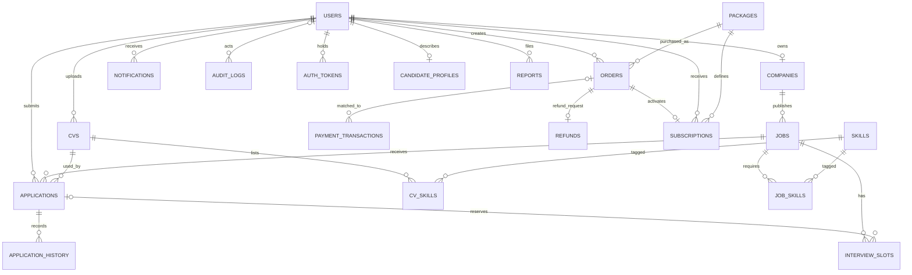

# Dữ liệu đang sử dụng

Nguồn schema thực thi là `backend/app/models.py`; migration nằm trong `backend/alembic/versions`. Sơ đồ này mô tả các bảng hiện có sau hợp nhất, không thay thế mô hình mục tiêu chi tiết trong Word.

| Bảng | Nội dung chính |
|---|---|
| `users` | Tài khoản, hash mật khẩu, vai trò, trạng thái, mốc Premium, thời điểm xác minh email, ảnh đại diện |
| `companies` | Hồ sơ công ty và trạng thái kiểm duyệt |
| `jobs` | Tin, kỹ năng, mức kinh nghiệm, thời hạn, vector và trạng thái xử lý (Nháp/Chờ duyệt/Đang hiển thị/Từ chối/Đã đóng), lượt xem |
| `cvs` | File/nội dung CV, dữ liệu trích xuất JSON, kỹ năng, CV mặc định, vector |
| `applications` | Ứng viên–Job–CV, trạng thái, điểm tại thời điểm nộp |
| `application_history` | Trạng thái trước/sau, người thao tác, thời điểm và ghi chú |
| `interview_slots` | Giờ bắt đầu/kết thúc, hold, đơn đã đặt, kết quả và phản hồi, thời điểm đã nhắc lịch |
| `packages` | Gói HR/ứng viên, giá, thời hạn, quota, bật/tắt bán |
| `orders` | Mã đơn unique, số tiền, thời hạn, trạng thái thanh toán (PENDING/RECONCILING/PAID/EXPIRED/CANCELLED/REFUND_REQUESTED/REFUNDED) |
| `payment_transactions` | Mã giao dịch SePay unique, payload, kết quả ghép đơn |
| `refunds` | Yêu cầu hoàn tiền và xử lý của admin |
| `subscriptions` | Quyền lợi từ đơn, thời hạn, trạng thái active và quota còn lại |
| `auth_tokens` | Hash SHA-256 của refresh token, token đặt lại mật khẩu và xác minh email; hạn dùng, thời điểm đã dùng/thu hồi |
| `candidate_profiles` | Hồ sơ nghề nghiệp ứng viên, cờ công khai với nhà tuyển dụng |
| `reports` | Báo cáo vi phạm (tin/công ty/người dùng), kết luận và người xử lý |
| `skills`, `cv_skills`, `job_skills` | Danh mục kỹ năng chuẩn hóa và bảng nối, đồng bộ từ cột JSON `skills` |
| `notifications` | Thông báo trong ứng dụng |
| `audit_logs` | Dấu vết thao tác nghiệp vụ/quản trị |

## Ràng buộc

- Email, mã gói, mã đơn và mã giao dịch SePay có unique.
- Một đơn đã thanh toán chỉ tạo một subscription nhờ unique `order_id`.
- Unique ứng tuyển áp dụng cho cặp `job_id/candidate_id` khi trạng thái chưa `REJECTED`/`WITHDRAWN`. Đơn lịch sử không bị xóa.
- Một đơn không giữ/đặt đồng thời nhiều slot đang hoạt động. Hold/confirm dùng cập nhật có điều kiện để chống hai người đặt cùng slot.
- `embedding` là kiểu vector trên PostgreSQL, JSON trên SQLite kiểm thử. Các bản ghi có nhãn model và revision để tránh trộn vector khác model.

## Khác biệt với mô hình mục tiêu trong Word

Source hoạt động cũ lưu nhiều trường CV trong JSON và kỹ năng trong danh sách JSON. Sau hợp nhất, schema này được giữ để không làm mất dữ liệu và hành vi hiện có. Chưa tách đầy đủ `candidate_profiles`, `hr_profiles`, danh mục `skills`, các bảng nối kỹ năng CV/Job, học vấn, kinh nghiệm, dự án/chứng chỉ và bảng booking/lịch sử booking riêng như thiết kế chi tiết trong tài liệu.

Khi chuẩn hóa các bảng này cần migration chuyển dữ liệu JSON hiện có và sửa repository/parser cùng một đợt. Không tạo các model rỗng rồi ghi rằng yêu cầu đã hoàn thành. Các thiếu sót được theo dõi trong [đối chiếu đặc tả](specification-alignment.md).
